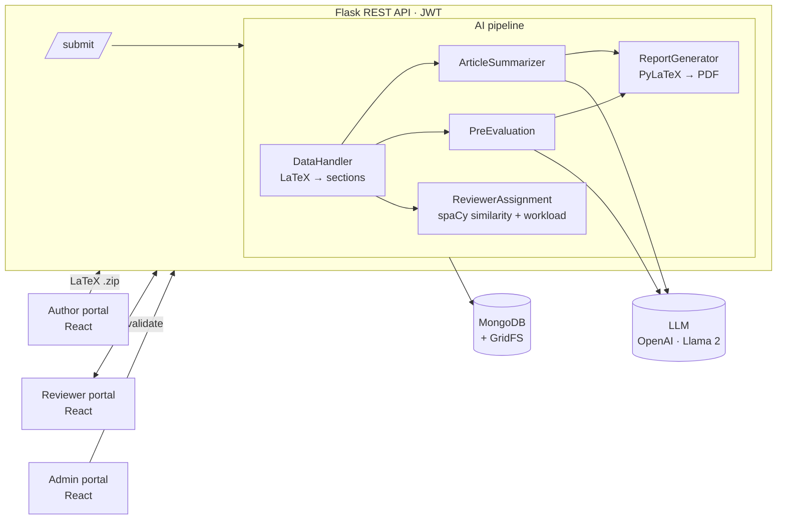

# The AI Congress

**Generative-AI engine that automates the peer-review workflow of a scientific conference.**

Authors upload a LaTeX manuscript; the platform parses it section by section, produces an AI summary and an AI pre-evaluation of every section, assigns the most suitable reviewer with NLP similarity scoring, and generates a PDF report that the human reviewer validates. Re-submissions are evaluated against the reviewer's previous comments.

> Bachelor's thesis — Computer Engineering, University of Seville · **Grade: 9.4/10**


---

## Why

Organising a scientific congress means hundreds of manuscripts, a limited pool of reviewers and weeks of manual triage. The AI Congress cuts that triage time: every submission arrives at the reviewer already summarised, pre-evaluated section by section, and routed to the reviewer whose expertise best matches the paper — while the final decision stays human.

## Key features

| Area | What it does |
|---|---|
| **Manuscript ingestion** | Accepts a zipped LaTeX project, extracts the `.tex` source, splits it into sections and converts LaTeX (including equations, via SymPy/ANTLR) into clean text/Markdown for the LLM. |
| **AI summary** | Section-by-section summaries generated with LangChain + OpenAI chat models. |
| **AI pre-evaluation** | Structured section-level evaluation driven by configurable system prompts. On re-submission, the prompt includes the reviewer's previous comments so the model checks whether they were addressed. |
| **Token-aware chunking** | Long sections are split with `tiktoken` + LangChain text splitters to respect each model's context window (GPT-3.5, GPT-4, GPT-4o, GPT-4o-mini). |
| **Smart reviewer assignment** | spaCy (`en_core_web_lg`) cosine similarity between the paper keywords and each reviewer's expertise, penalised by current workload (`0.9^pending`, max 4 pending reviews). A ranked backup list allows instant re-assignment. |
| **PDF report** | A LaTeX report (PyLaTeX) with summary and pre-evaluation, compiled to PDF and stored in MongoDB (GridFS). |
| **Pluggable LLMs** | OpenAI models or a self-hosted Llama 2 13B chat model served by the University of Seville's AI platform. Models are managed through the `/models` API. |
| **Three portals** | Author portal, reviewer portal and admin portal (React), bilingual (EN/ES) with i18n. |
| **Security** | JWT authentication, salted PBKDF2-SHA256 password hashing (Werkzeug), ORCID-bound registration tokens for reviewers. |

## Architecture



Each submission is processed in a background thread so the author gets an immediate `201` response while the pipeline runs.

## Tech stack

- **Backend:** Python 3.10, Flask 3, Flask-JWT-Extended, MongoEngine / PyMongo, Gunicorn
- **AI / NLP:** LangChain, OpenAI API, tiktoken, spaCy, Llama 2 (self-hosted), SymPy, pydetex
- **Frontend:** React 18, React Router 6, i18next, React-Bootstrap, react-pdf
- **Data:** MongoDB + GridFS
- **Infra:** Docker, Docker Compose, Nginx (production configs in `conf/.conf_test`)

## Project structure

```
client/              React app — author, reviewer and admin portals
server/src/
  app.py             Flask app factory, blueprints, Mongo connection
  routes/            REST endpoints (users, submit, evaluate, models, admin)
  services/          AI pipeline: data preparation, GPT/Llama handlers,
                     summary, pre-evaluation, reviewer assignment, report
  models/            MongoEngine documents (users, manuscripts)
  tests/             integration and unit test scripts
conf/                docker-compose and Nginx configurations
docs/API.md          Full REST API reference
utils/               Database and analysis diagrams (PlantUML, draw.io)
```

## Getting started

**Requirements:** Docker and Docker Compose, an OpenAI API key.

1. Create `server/.env`:

   ```env
   MONGO_URI=mongodb://mongodb:27017/congresodb
   JWT_KEY=change-me
   GPT_KEY=sk-...
   LLAMUS_KEY=          # optional: University of Seville Llama endpoint
   EMAIL_HF=            # optional
   PASS_HF=             # optional
   ```

2. Build and start the stack:

   ```bash
   ./scripts/build.sh      # docker-compose -f conf/docker-compose.yml up --build
   ```

3. Open the app at <http://localhost:3000> (API at <http://localhost:5000/api/v1>).

## API

The REST API is versioned under `/api/v1`. See the full reference in **[docs/API.md](docs/API.md)**.

## Roadmap

- Replace polling with WebSocket notifications for pipeline status
- Evaluation dataset to benchmark summary and pre-evaluation quality across models
- Cloud deployment (Azure Container Apps) with CI/CD

## Author

**Ouael Boussiali** — AI Engineer · [LinkedIn](https://www.linkedin.com/in/ouael-boussiali/) · [GitHub](https://github.com/OUABSL)
